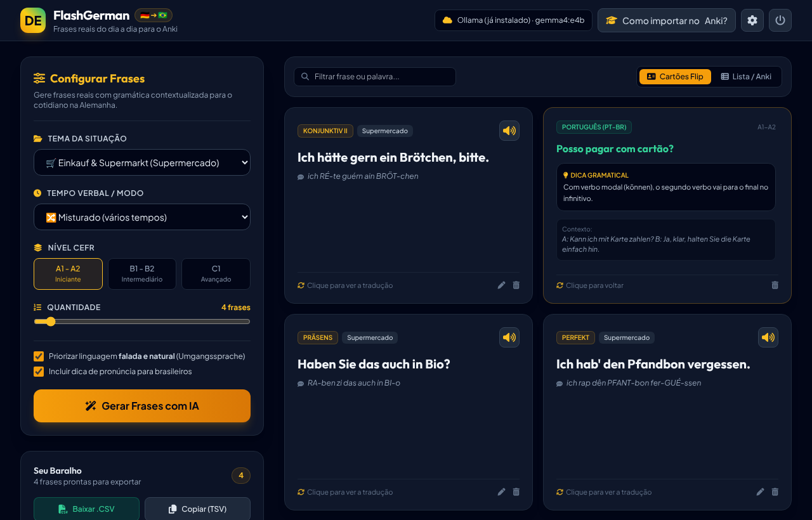
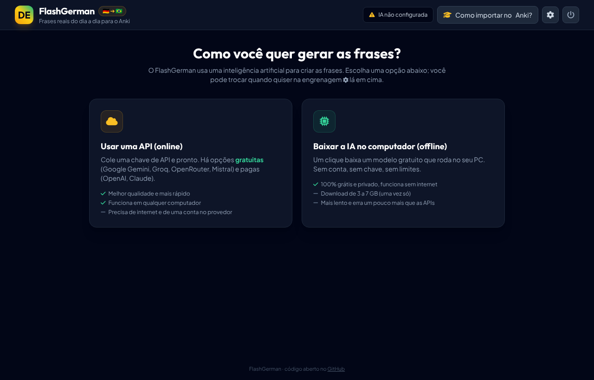
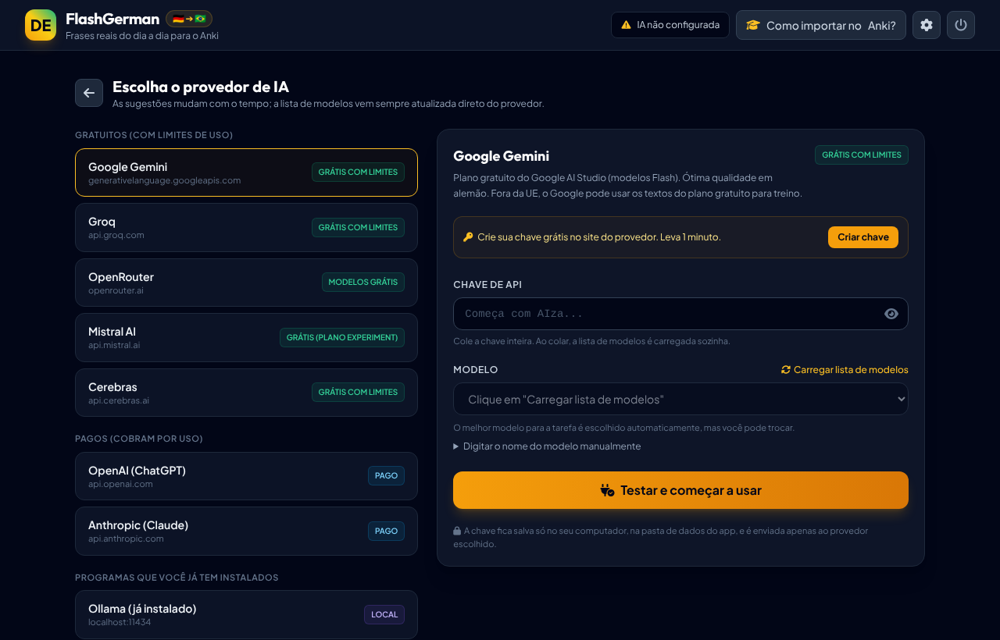
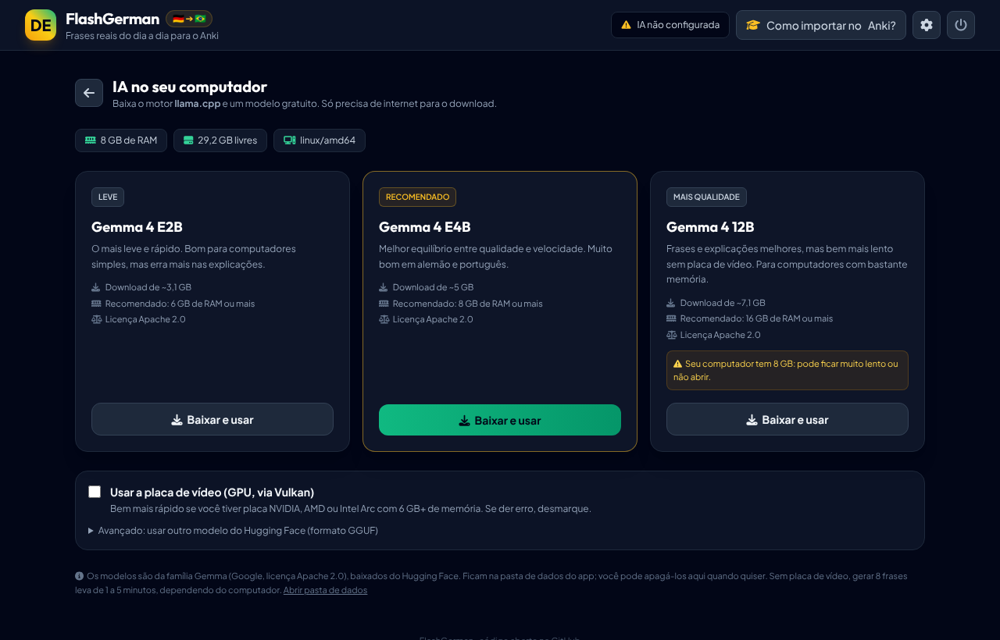

<p align="center">
  
</p>

<h1 align="center">FlashGerman</h1>

<p align="center">
  Gerador de frases <b>reais do dia a dia em alemão</b>, com tradução natural para o português do Brasil,<br>
  explicação gramatical, dica de pronúncia e diálogo de contexto, prontas para importar no <b>Anki</b>.
</p>

<p align="center">
  <a href="../../releases/latest"><b>⬇️ Baixar a versão mais recente</b></a>
</p>



## O que ele faz

- Gera frases por **tema** (supermercado, médico, trabalho, burocracia, aluguel... ou um tema seu), **tempo verbal** (Präsens, Perfekt, Präteritum, Futur I, Konjunktiv II) e **nível** (A1 a C1).
- Cada cartão traz: frase em alemão, tradução idiomática, tradução literal, explicação gramatical pensada para brasileiros, dica de pronúncia e um mini diálogo.
- Mostra os cartões com efeito de "virar", lê a frase em voz alta, permite editar e apagar.
- Exporta um **CSV pronto para o Anki** (o Anki já reconhece separador, HTML e etiquetas) ou copia em TSV para outros apps de flashcards.
- O baralho fica salvo no computador entre uma sessão e outra.

## Como usar

1. Baixe o arquivo do seu sistema na [página de downloads](../../releases/latest):

   | Sistema | Arquivo |
   |---|---|
   | **Windows** (a maioria dos PCs) | `FlashGerman-windows-x64.zip` |
   | **Mac** com chip Apple (M1, M2, M3, M4…) | `FlashGerman-macos-apple-silicon.zip` |
   | Mac com Intel | `FlashGerman-macos-intel.zip` |
   | Linux | `FlashGerman-linux-x64.tar.gz` |

2. Extraia e abra o **FlashGerman**. Não precisa instalar nada: é um único arquivo de ~8 MB.
3. Na primeira vez, escolha como a IA vai funcionar (veja abaixo). Depois é só gerar as frases.

O app abre numa janela própria (usa o Edge, Chrome ou Brave que já existe no computador). Fechou a janela, fechou o app.

> **Windows:** se aparecer "O Windows protegeu o computador", clique em **Mais informações → Executar assim mesmo**. O aviso aparece com qualquer programa novo sem certificado de assinatura (que é pago).
>
> **macOS:** na primeira vez, clique com o botão direito no app e escolha **Abrir**. Se o macOS disser que não pode verificar o desenvolvedor, vá em **Ajustes do Sistema → Privacidade e Segurança** e clique em **Abrir Mesmo Assim**. Se aparecer "o app está danificado", rode no Terminal: `xattr -cr /caminho/para/FlashGerman.app`.

## Escolhendo a IA



### Opção 1: API (online)



Cole uma chave de API e escolha o modelo. A lista de modelos vem **direto do provedor**, então está sempre atualizada; o app já seleciona o mais indicado para a tarefa.

| Provedor | Custo | Onde criar a chave |
|---|---|---|
| Google Gemini | Plano gratuito com limites (modelos "Flash") | [aistudio.google.com/apikey](https://aistudio.google.com/apikey) |
| Groq | Plano gratuito com limites | [console.groq.com/keys](https://console.groq.com/keys) |
| OpenRouter | Vários modelos `:free` gratuitos | [openrouter.ai/keys](https://openrouter.ai/keys) |
| Mistral AI | Plano gratuito "Experiment" | [console.mistral.ai/api-keys](https://console.mistral.ai/api-keys) |
| Cerebras | Plano gratuito com limites | [cloud.cerebras.ai](https://cloud.cerebras.ai/) |
| OpenAI | Pago por uso | [platform.openai.com/api-keys](https://platform.openai.com/api-keys) |
| Anthropic (Claude) | Pago por uso | [platform.claude.com/settings/keys](https://platform.claude.com/settings/keys) |
| Ollama / LM Studio | Grátis, roda no seu PC | Basta estar aberto |
| Qualquer API compatível com OpenAI | Depende | Informe o endereço `/v1` |

Planos gratuitos e limites mudam com frequência; confira no site de cada provedor. **Dica:** se não sabe por onde começar, use o **Google Gemini**.

### Opção 2: IA no computador (offline, um clique)



O app baixa sozinho o motor [llama.cpp](https://github.com/ggml-org/llama.cpp) e um modelo gratuito da família **Gemma** (Google, licença Apache 2.0) do Hugging Face:

| Modelo | Download | RAM recomendada | Para quem |
|---|---|---|---|
| Leve | ~3 GB | 6 GB | Computadores simples |
| **Recomendado** | ~5 GB | 8 GB | A maioria |
| Mais qualidade | ~7 GB | 16 GB | PCs com bastante memória ou placa de vídeo |

- O download continua de onde parou se for interrompido e o arquivo é conferido (SHA-256) no final.
- Em Windows e Linux há a opção de usar a **placa de vídeo** (Vulkan). No Mac com chip Apple a aceleração já vem ligada.
- Sem placa de vídeo, gerar 8 frases leva de 1 a 5 minutos. Modelos locais pequenos erram um pouco mais que as APIs; revise os cartões.
- Avançado: dá para baixar qualquer outro modelo GGUF do Hugging Face informando `usuario/repositorio`.

A lista de modelos recomendados fica no arquivo [`catalog.json`](catalog.json). O app busca a versão mais nova desse arquivo aqui no GitHub ao abrir, então as recomendações podem ser atualizadas sem lançar uma nova versão do programa.

## Importando no Anki

1. Clique em **Baixar .CSV**.
2. No Anki (2.1.54 ou mais novo): **Arquivo → Importar** e escolha o arquivo.
3. Escolha o tipo de nota **Básico** e o baralho de destino. Separador, HTML e etiquetas já vêm configurados.

As etiquetas seguem o padrão `FlashGerman::Tema::Supermercado`, `FlashGerman::Tempo::Perfekt` e `FlashGerman::Nivel::A1-A2`, o que facilita montar baralhos filtrados.

## Privacidade e arquivos

- Tudo fica na pasta **`data`**, ao lado do programa (no macOS, em `~/Library/Application Support/FlashGerman`): configurações, chaves de API, baralho, motor e modelos.
- As chaves de API ficam só no seu computador e só são enviadas ao provedor escolhido. **Não compartilhe a pasta `data`.**
- O programa só aceita conexões do próprio computador (`127.0.0.1`), com um token secreto por sessão.
- Para desinstalar, apague a pasta do programa (e a pasta `data`).

## Problemas comuns

| Sintoma | Solução |
|---|---|
| "A chave de API foi recusada" | Copie a chave de novo, inteira. Algumas chaves levam alguns minutos para ativar. |
| "Limite de uso atingido (429)" | O plano gratuito tem limite por minuto/dia. Espere, gere menos frases por vez ou troque de provedor. |
| A IA local fecha ao iniciar | Pode faltar memória. Tente o modelo **Leve** ou desmarque a opção de GPU. Detalhes em `data/logs/llama-server.log`. |
| Não abre janela, só o navegador | Normal se não houver Edge/Chrome/Brave instalado. Funciona igual. |
| A voz não fala alemão | Instale o idioma alemão nas configurações de fala/voz do sistema. |

Logs do app: `data/logs/app.log`.

---

## Para desenvolvedores

O FlashGerman é um servidor local em **Go** (só biblioteca padrão, sem dependências) com a interface em HTML/JS embutida no executável.

```
main.go          início, instância única, encerramento
app.go           estado do app e ciclo de vida da janela
server.go        rotas HTTP /api e arquivos da interface
providers.go     APIs (formato OpenAI e Anthropic), streaming, lista de modelos
prompt.go        prompt, JSON Schema e leitura tolerante da resposta
jobs.go          gerações em segundo plano com progresso e cancelamento
local.go         IA local: baixa o llama.cpp e o modelo, controla o llama-server
download.go      downloads com retomada, SHA-256 e extração zip/tar.gz
window.go        abre a janela "modo aplicativo" no Edge/Chrome
platform_*.go    detalhes de cada sistema (RAM, disco, processos)
catalog.json     provedores sugeridos, modelos locais e motor (atualizável remotamente)
web/             interface (index.html, app.js, anki.js, CSS e fontes locais)
tools/web/       gera o CSS do Tailwind e copia fontes/ícones (Node)
scripts/build.sh compila e empacota para todos os sistemas
```

Rodar em modo desenvolvimento (precisa do [Go](https://go.dev/dl/) 1.24+):

```bash
go run .                 # abre a janela
go run . --no-window     # só o servidor; mostra o endereço
go test ./...            # testes (inclui um llama-server e provedores falsos)
node tools/web/test/anki.test.mjs
```

Alterou classes do Tailwind no `index.html`/`app.js`? Gere o CSS de novo:

```bash
cd tools/web && npm install && npm run build
```

Publicar uma versão nova (o GitHub Actions compila e cria a página de downloads):

```bash
git tag v1.0.1
git push origin v1.0.1
```

## Créditos e licenças

- Código do FlashGerman: [MIT](LICENSE).
- Motor de IA local: [llama.cpp](https://github.com/ggml-org/llama.cpp) (MIT), baixado na primeira utilização.
- Modelos sugeridos: [Gemma](https://ai.google.dev/gemma) (Apache 2.0), em versões GGUF publicadas pela [Unsloth](https://huggingface.co/unsloth) no Hugging Face.
- Ícones: [Font Awesome Free](https://fontawesome.com/license/free) (CC BY 4.0 / SIL OFL). Fontes: Outfit e Plus Jakarta Sans (SIL OFL), via Fontsource.
- Estilos: [Tailwind CSS](https://tailwindcss.com) (MIT).
